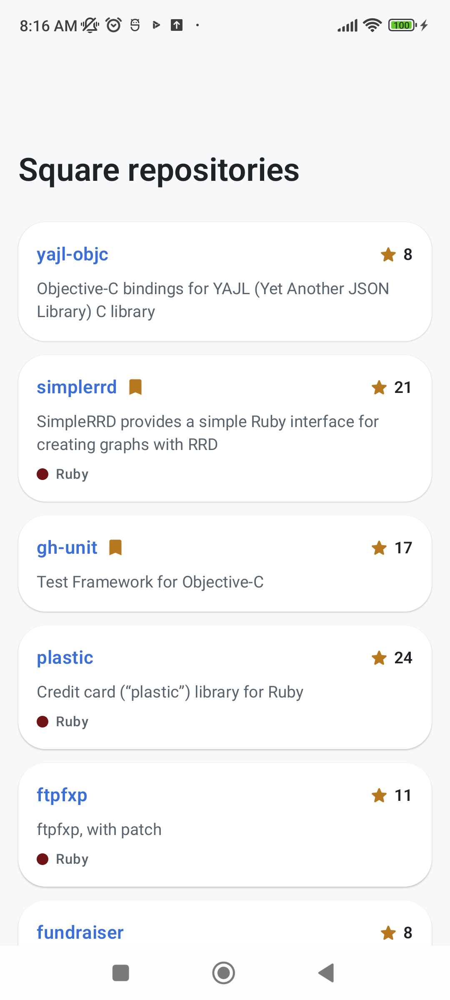
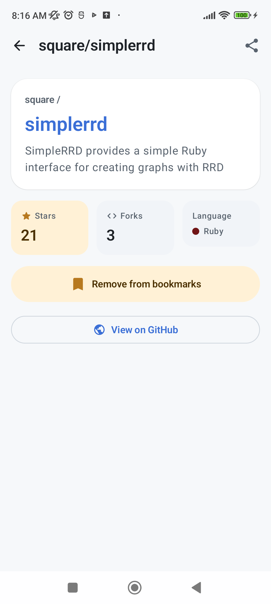
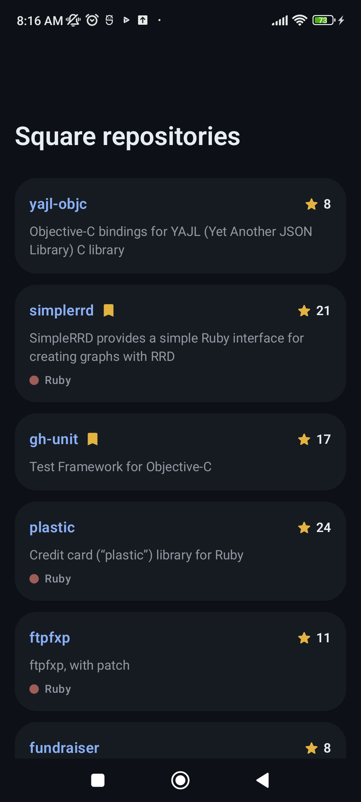
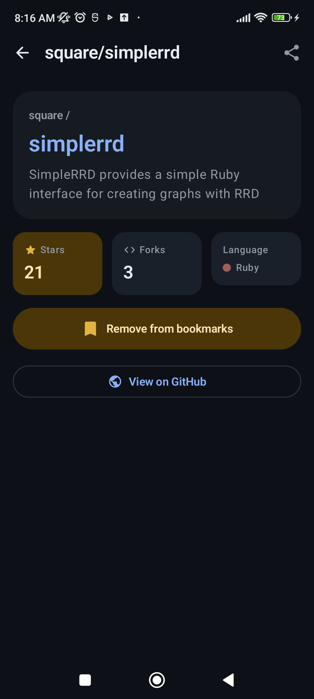
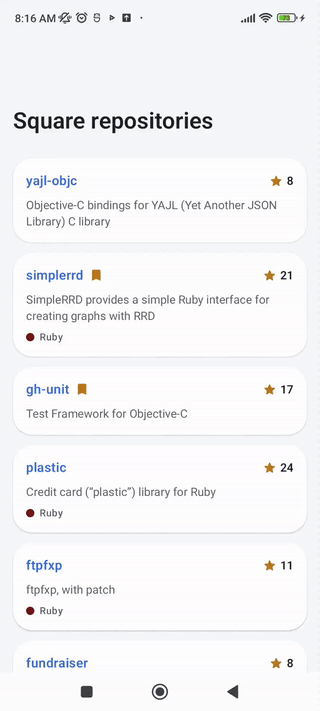
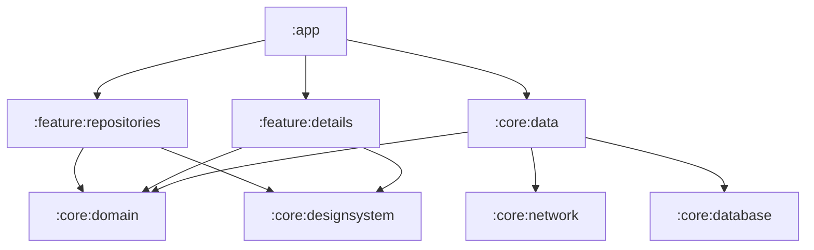

# Square Repos

[](https://github.com/bassanthassanibrahim/square-repos-android/actions/workflows/ci.yml)

An Android app that lists [Square](https://github.com/square)'s open-source repositories from GitHub, works offline, and lets you bookmark your favorites.

Kotlin · Jetpack Compose (Material 3) · Clean Architecture (MVVM + UDF) · Hilt · Room · Paging 3 + RemoteMediator · Retrofit + kotlinx.serialization · Coroutines/Flow · multi-module with Gradle convention plugins.

| List | Details (bookmarked) | List (dark) | Details (dark) | Demo |
|---|---|---|---|---|
|  |  |  |  |  |

---

## Requirements → Implementation

| | Requirement | Where |
|---|---|---|
| ✅ | Fetch Square's repositories from `api.github.com/orgs/square/repos` | [`GitHubApi`](core/network/src/main/kotlin/com/bassant/squarerepos/core/network/GitHubApi.kt) |
| ✅ | Show each repository's name and stars | [`RepoCard`](feature/repositories/src/main/kotlin/com/bassant/squarerepos/feature/repositories/component/RepoCard.kt), [`StarCount`](core/designsystem/src/main/kotlin/com/bassant/squarerepos/core/designsystem/component/StarCount.kt) |
| ✅ | Store the data in a database | [`SquareReposRemoteMediator`](core/data/src/main/kotlin/com/bassant/squarerepos/core/data/paging/SquareReposRemoteMediator.kt) writes pages to [Room](core/database/src/main/kotlin/com/bassant/squarerepos/core/database/SquareReposDatabase.kt) |
| ✅ | Display the list from the database | [`OfflineFirstRepoRepository`](core/data/src/main/kotlin/com/bassant/squarerepos/core/data/repository/OfflineFirstRepoRepository.kt): the `Pager` reads Room's [`RepoDao.pagingSource()`](core/database/src/main/kotlin/com/bassant/squarerepos/core/database/dao/RepoDao.kt) |
| ✅ | Pagination | Paging 3 + [`SquareReposRemoteMediator`](core/data/src/main/kotlin/com/bassant/squarerepos/core/data/paging/SquareReposRemoteMediator.kt) (30 per page, next page stored in `remote_keys`) |
| ✅ | All loading states | [`ReposScreen`](feature/repositories/src/main/kotlin/com/bassant/squarerepos/feature/repositories/ReposScreen.kt): skeleton, full-screen error + Retry, offline snackbar + Retry, footer spinner / inline Retry, end of list, empty |
| ✅ | Details screen with name and stars | [`DetailsScreen`](feature/details/src/main/kotlin/com/bassant/squarerepos/feature/details/DetailsScreen.kt) |
| ✅ | Details model read reactively, not passed by bundle | Only `repoId` is navigated ([`DetailsDestination`](feature/details/src/main/kotlin/com/bassant/squarerepos/feature/details/navigation/DetailsNavigation.kt)); [`DetailsViewModel`](feature/details/src/main/kotlin/com/bassant/squarerepos/feature/details/DetailsViewModel.kt) observes Room through `ObserveRepoUseCase` |
| ✅ | Add / remove a bookmark in details (local only) | [`SetBookmarkUseCase`](core/domain/src/main/kotlin/com/bassant/squarerepos/core/domain/usecase/SetBookmarkUseCase.kt) → [`LocalBookmarkRepository`](core/data/src/main/kotlin/com/bassant/squarerepos/core/data/repository/LocalBookmarkRepository.kt) → `bookmarks` table |
| ✅ | Bookmark icon next to the name in the list | [`RepoCard`](feature/repositories/src/main/kotlin/com/bassant/squarerepos/feature/repositories/component/RepoCard.kt) (animated badge, updates instantly) |
| ✅ | Unique UI and micro-interactions | Shared-element card transition ([`SharedTransitions`](core/designsystem/src/main/kotlin/com/bassant/squarerepos/core/designsystem/component/SharedTransitions.kt)), [`AnimatedBookmarkIcon`](core/designsystem/src/main/kotlin/com/bassant/squarerepos/core/designsystem/component/BookmarkIcon.kt) + haptics, staggered details entrance, count-up stats, shimmer, press scale |
| ✅ | Documented, scalable project | KDoc on public classes, 8 modules, [convention plugins](build-logic/convention/src/main/kotlin), CI |

---

## Architecture



| Module | Contents |
|---|---|
| `:app` | Application, `MainActivity`, navigation graph. The only module that knows every feature. |
| `:feature:repositories` | List screen + `ReposViewModel` |
| `:feature:details` | Details screen + `DetailsViewModel` (bookmark toggle, share) |
| `:core:domain` | `Repo`, repository interfaces, use cases, `DataError`. Pure Kotlin, no Android. |
| `:core:data` | `OfflineFirstRepoRepository`, `RemoteMediator`, mappers, Hilt bindings |
| `:core:network` | Retrofit API, DTOs, OkHttp setup |
| `:core:database` | Room database, entities, DAOs, exported schema |
| `:core:designsystem` | Theme and shared components |
| `build-logic` | Gradle convention plugins, so each module's build file is a few lines |

- **Features never depend on each other.** They only see `:core:domain` and `:core:designsystem`; `:app` wires the navigation.
- **Room is the single source of truth.** The network only writes to Room (through the `RemoteMediator`); the UI only reads Room.
- **UDF:** each screen has one `UiState` (or `PagingData`) going down and events going up to its ViewModel.

---

## Key decisions

| Decision | Why |
|---|---|
| **Paging 3 + `RemoteMediator`** | Matches "fetch → store → display from DB → paginate", with load states and retry built in. |
| **Bookmarks in their own table + `EXISTS(...) AS is_bookmarked`** | Refreshing clears the repo cache; bookmarks must survive. The list and details queries join the flag, so both screens update reactively. |
| **`setBookmarked(id, target)`, not `toggle`** | Idempotent: fast double taps can't leave a wrong state. |
| **1-hour cache freshness** | A fresh cache skips the startup network call: instant launch, and it protects GitHub's 60 requests/hour limit. |
| **Errors mapped to `DataError`** | The UI shows the real reason (offline, rate limit with reset time, server error) without knowing Retrofit/OkHttp. |
| **Only the id goes to Details** | Required by the task; also survives process death via `SavedStateHandle`. |
| **`PagingDataPresenter` in `ReposViewModel`** | A bookmark change invalidates the list while it is off screen, and `cachedIn` only loads the new generation when collected. Without it the list came back empty (skeleton flash, lost back transition). The ViewModel keeps the newest generation loaded. |
| **Language dots with minimum 3:1 contrast** | GitHub's colors are made for white; some disappear on dark cards. They are nudged to WCAG's 3:1 for graphics. |

---

## Getting started

1. Open the project in Android Studio and run the `app` configuration (JDK 17, compile SDK 35, min SDK 26).
2. *(Optional)* Raise GitHub's rate limit from 60 to 5,000 requests/hour by adding a [token](https://github.com/settings/tokens) (no scopes) to `local.properties`, which is git-ignored:
   ```properties
   github.token=ghp_your_token
   ```

---

## Testing

```bash
./gradlew testDebugUnitTest :core:domain:test   # 37 unit tests
./gradlew lintDebug
```

| Module | Tests | What is covered |
|---|---|---|
| `:core:data` | 10 | `RemoteMediator`: refresh, append to the end, bookmarks survive refresh, offline keeps the cache, cache freshness. Error mapping. |
| `:core:database` | 3 | Reactive bookmark join, clearing the cache keeps bookmarks, no duplicate bookmarks. |
| `:core:network` | 2 | GitHub JSON parsing and defaults. |
| `:core:domain` | 2 | `SetBookmarkUseCase` passes the target state and is idempotent. |
| `:core:designsystem` | 6 | Compact counts (`46.1k`), language dot contrast on light and dark cards. |
| `:feature:details` | 8 | ViewModel: reactive updates, bookmark add/remove, not found. Compose UI: bookmark button, not found. |
| `:feature:repositories` | 6 | ViewModel paging. Compose UI: name, stars, badge, click, offline snackbar messages, list kept while Room reloads. |

JUnit4, Turbine, kotlinx-coroutines-test, Paging testing and Robolectric (Room and Compose run on the JVM). Fakes, no mocks.

**CI** ([workflow](.github/workflows/ci.yml)) runs the tests, Android lint and the debug build on every push and pull request to `main` and `develop`, and uploads the debug APK as an artifact.
